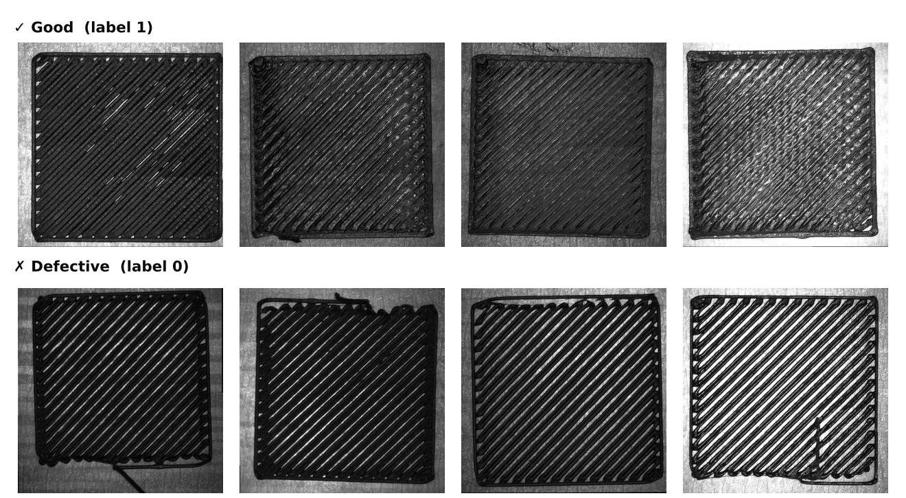
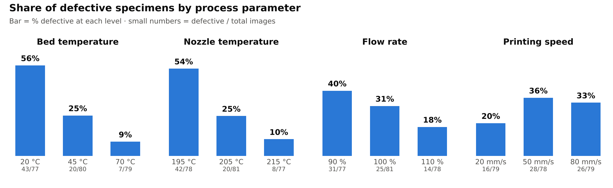

<div align="center">

# 🔬 AM-IQD
### Additive Manufacturing Image Quality Dataset

**236 microscope images of PLA specimens printed by Material Extrusion, labelled as good or defective by three expert raters**


[](https://creativecommons.org/licenses/by/4.0/)

[Overview](#-overview) •
[Acquisition](#-specimens-and-image-acquisition) •
[Labelling](#%EF%B8%8F-labelling) •
[Data Format](#-data-format) •
[Quick Start](#-quick-start) •
[Use Cases](#-use-cases) •
[Citation](#-citation)

</div>

---

## 🔍 Overview

**AM-IQD** is an image dataset for **visual quality assessment in Additive Manufacturing**. It contains high-resolution transmitted-light micrographs of PLA specimens printed by fused filament fabrication. Each image is labelled as **good** or **defective** based on its visible surface and structural characteristics.

The specimens are the same as those of the companion dataset [**AM-QED**](https://github.com/engat27/AM-Quality-Energy-Dataset-AM-QED-), which provides process parameters, void fraction and energy consumption. The two datasets can be used together to link **process parameters**, **measured quality** and **visual appearance**.

<div align="center">
<picture>
  <source media="(prefers-color-scheme: dark)" srcset="assets/samples_dark.png">
  
</picture>
</div>

### ✨ At a glance

| | |
|---|---|
| 🖼️ **Images** | 236 JPEG images, 1920 × 1200 pixels |
| 🏷️ **Classes** | ✅ good (label 1): 166 · ❌ defective (label 0): 70 · ratio ≈ 2.37 : 1 |
| 👥 **Annotation** | 3 independent expert raters · 96.7% agreement · Cohen's κ = 0.87 |
| 🖨️ **Printer** | CreatBot F430 (fused filament fabrication) |
| 🧵 **Material** | PLA filament, 1.75 mm diameter · 0.4 mm nozzle |
| 🔬 **Microscope** | HIROX RH-2000 digital microscope, transmitted (back) light |
| 🎛️ **Process parameters** | Bed temperature, nozzle temperature, flow rate, printing speed (3 levels each) |

---

## 🧪 Specimens and Image Acquisition

### Specimens

Specimens were printed with a **CreatBot F430** fused filament fabrication printer, using **PLA filament** (1.75 mm diameter) and a **0.4 mm nozzle**. They follow the full factorial design of [AM-QED](https://github.com/engat27/AM-Quality-Energy-Dataset-AM-QED-):

| Parameter          | Levels                     |
|--------------------|----------------------------|
| 🌡️ Bed temperature    | 20 · 45 · 70 °C            |
| 🔥 Nozzle temperature | 195 · 205 · 215 °C         |
| 💧 Flow rate          | 90 · 100 · 110 % of nominal |
| 🚀 Printing speed     | 20 · 50 · 80 mm/s          |

### Microscope

Images were acquired with a **HIROX RH-2000** digital microscope equipped with an **MXB-5040Z** lens and a **LOW X20** objective adapter. The microscope has a 360° rotating head and interchangeable adapters, with magnifications from 20× to 800×.

### Backlight setup

Acquisition used a purpose-built **transmitted-light (backlight) setup**:

- a diffused light source is placed **beneath** the specimens;
- specimens rest on a **transparent glass plate** held by a dedicated support, so light passes through them;
- this makes deposition defects and voids more visible and reduces reflections from the PLA surface, which could otherwise be mistaken for voids.

As a result, images show a **bright background**, **darker PLA material** and **bright void regions**.

### Tiling

Each final image was obtained by **tiling**: several partially overlapping acquisitions were stitched into a single, larger image of the whole specimen.

---

## 🏷️ Labelling

Each image was assigned a binary label:

| Label | Class | Images | Share |
|:-----:|-------|-------:|------:|
| `1` | ✅ **good**      | 166 | 70.3% |
| `0` | ❌ **defective** | 70  | 29.7% |

Labelling was carried out by **three independent raters** with complementary expertise:

| Rater | Expertise |
|-------|-----------|
| **A** | Author, expert in Additive Manufacturing |
| **B** | Process engineer |
| **C** | Expert in advanced manufacturing systems and AM process optimization |

Each rater independently judged the images on their **visible surface and structural characteristics**. The raters agreed on **235 out of 243 cases (96.7%)**, with a **Cohen's kappa of 0.87**, indicating a high level of inter-rater agreement.

<div align="center">
<picture>
  <source media="(prefers-color-scheme: dark)" srcset="assets/defect_rate_dark.png">
  
</picture>
</div>

> 💡 Defects become much less frequent at higher bed and nozzle temperatures: about 1 specimen in 2 is defective at 20 °C bed temperature, against fewer than 1 in 10 at 70 °C.

---

## 📊 Data Format

### Images

- **Format:** JPEG, 1920 × 1200 pixels
- **Colour:** grayscale content, stored with three identical RGB channels. Convert to 8-bit grayscale with, for example, `Image.open(path).convert("L")`.
- **Organisation:** one folder per class, `images/good/` and `images/defective/`.

### File names

File names encode the printing conditions:

```
gcode<G>_rep<R>_<speed>.<flow> sk<S>.jpg
```

| Field     | Meaning | Values |
|-----------|---------|--------|
| `G`       | Print job, one per bed temperature | 1 = 20 °C · 2 = 45 °C · 3 = 70 °C |
| `R`       | Replica | 1 · 2 · 3 |
| `speed`   | Printing speed (mm/s) | 20 · 50 · 80 |
| `flow`    | Flow rate (% of nominal) | 90 · 100 · 110 |
| `S`       | Chessboard on the build plate, one per nozzle temperature | 1 = 195 °C · 2 = 205 °C · 3 = 215 °C |

Example: `gcode2_rep3_50.110 sk3.jpg` is a specimen printed with a 45 °C bed, 215 °C nozzle, 110% flow rate and 50 mm/s speed, replica 3.

Some files in `images/defective/` carry an `R` prefix, and a few use `rep1.1` or `prov1` instead of `rep1`. **The label is defined by the folder and by `labels.csv`, not by the file name.**

### `labels.csv`

One row per image, with the label and the decoded process parameters:

| Column          | Description |
|-----------------|-------------|
| `filename`      | Relative path of the image (e.g. `images/good/gcode1_rep1_20.110 sk1.jpg`) |
| `label`         | `good` or `defective` |
| `label_id`      | `1` = good, `0` = defective |
| `bed_temp_C`    | Bed temperature (°C) |
| `nozzle_temp_C` | Nozzle temperature (°C) |
| `flow_rate_pct` | Flow rate (% of nominal) |
| `speed_mm_s`    | Printing speed (mm/s) |
| `replica`       | Replica number (1–3) |
| `chessboard`    | Chessboard on the build plate (1–3) |

---

## 🚀 Quick Start

**With PyTorch**: the folder structure works directly with `ImageFolder`. Classes are sorted alphabetically, so `defective` = 0 and `good` = 1, matching `label_id`.

```python
from torchvision import datasets, transforms

tf = transforms.Compose([
    transforms.Grayscale(num_output_channels=1),
    transforms.Resize((240, 384)),
    transforms.ToTensor(),
])
ds = datasets.ImageFolder("images", transform=tf)
print(ds.class_to_idx)   # {'defective': 0, 'good': 1}
```

**With pandas**: load labels and process parameters.

```python
import pandas as pd
from PIL import Image

df = pd.read_csv("labels.csv")
print(df["label"].value_counts())

img = Image.open(df.loc[0, "filename"]).convert("L")
```

> ⚠️ The classes are **imbalanced** (≈ 2.37 : 1). Use stratified splits and report metrics such as F1-score, balanced accuracy or MCC. Replicas share the same printing conditions, so consider grouping by parameter combination when splitting.

---

## 💡 Use Cases

- 🧠 **Binary defect classification**: good vs defective with CNNs, Vision Transformers or classical features
- 🔁 **Transfer learning and few-shot learning** on a small, high-resolution industrial dataset
- 🔎 **Explainable AI**: checking that models focus on the actual defect regions
- 🔗 **Linking image, process and quality**: combining AM-IQD with [AM-QED](https://github.com/engat27/AM-Quality-Energy-Dataset-AM-QED-) (process parameters, void fraction, energy consumption)
- 🛡️ **Robustness and security of ML in manufacturing**: label noise, data poisoning, adversarial examples

---

## 📁 Repository Structure

```
AM-IQD/
├── images/
│   ├── good/          # 166 images (label 1)
│   └── defective/     # 70 images (label 0)
├── assets/            # Figures used in this README
├── labels.csv         # Labels and process parameters for each image
└── README.md
```

---

## 📚 Citation

A paper describing AM-IQD is in preparation. Until it is published, please cite the dataset as:

```bibtex
@misc{amiqd2026,
  author       = {AUTHOR LIST},
  title        = {{AM-IQD}: Additive Manufacturing Image Quality Dataset},
  year         = {2026},
  howpublished = {\url{https://github.com/engat27/AM-IQD}}
}
```

The specimens are those of AM-QED. If you also use the process, void fraction or energy data, please cite:

```bibtex
@article{devito2026dual,
  author    = {Devito, Fabrizia and Gattulli, Vincenzo and Impedovo, Donato and Musti, Luca},
  title     = {A dual-module machine learning framework for joint quality risk assessment and energy-aware process optimization in additive manufacturing},
  journal   = {Journal of Intelligent Manufacturing},
  year      = {2026},
  publisher = {Springer},
  doi       = {10.1007/s10845-026-02905-4}
}
```

---

## 📝 License

This dataset is released under the [Creative Commons Attribution 4.0 International (CC BY 4.0)](https://creativecommons.org/licenses/by/4.0/) license. You are free to share and adapt it, provided you give appropriate credit.

---

## 📬 Contact

For questions, issues or collaborations, please [open an issue](../../issues) in this repository.

<div align="center">
<sub>⭐ If you find AM-IQD useful, consider starring the repository!</sub>
</div>
